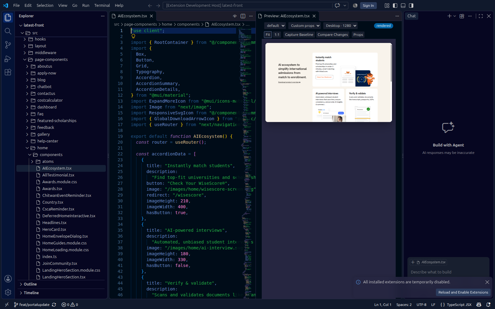
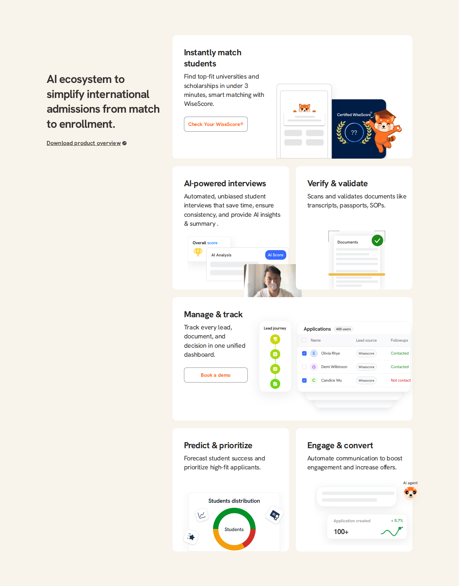
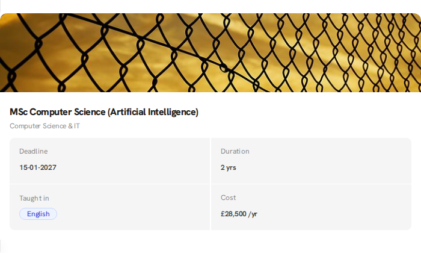
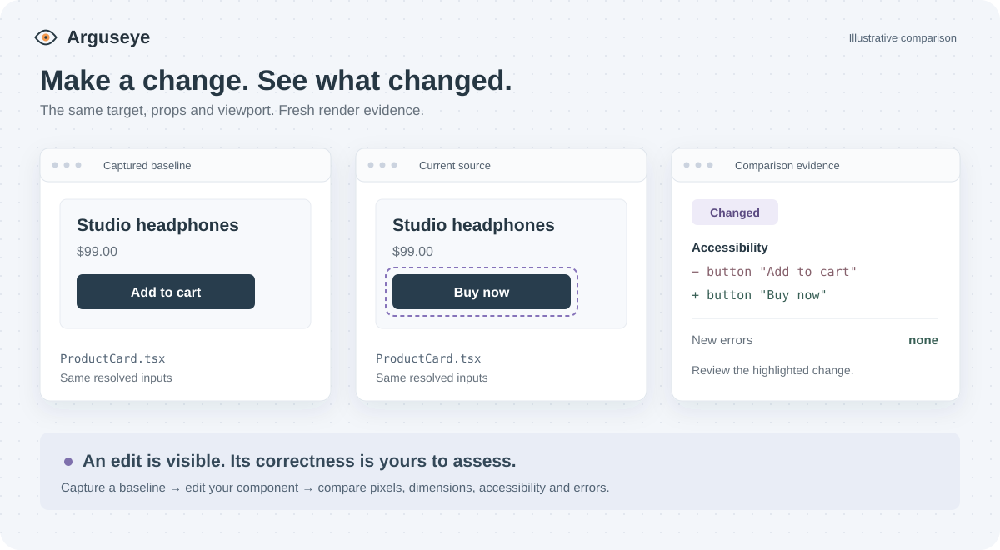

<p align="center">
  
</p>

<p align="center">
  <a href="https://github.com/DarkWorldCoder/arguseye/actions/workflows/ci.yml"></a>
  <a href="https://www.npmjs.com/package/arguseye"></a>
  <a href="LICENSE"></a>
  
  
  <a href="CONTRIBUTING.md"></a>
</p>

# Arguseye

**Your coding agent can see what it just built.**

Arguseye renders any React, Next.js or Vue component from source, exactly as your app shows it, with the dev server off. Real props come from the places your code already uses the component; your theme, layouts and global CSS apply. The agent gets a cropped PNG, the accessibility tree, what changed since its last render, and errors with file paths, in one call that takes about 40 ms when warm.

```bash
npx arguseye install claude      # or codex, cursor, windsurf, vscode, antigravity, copilot, all
```

One command writes the MCP server and the skill where your agent reads them. Then tell the agent: *look at the card you just changed.*

<p align="center">
  
</p>

## Why an agent needs eyes

Coding agents write UI blind. They edit a component, read the code back, and declare it done. The button that wraps onto two lines, the card that lost its padding, the theme that never applied: none of that is visible in a diff. The usual remedy is to start the dev server, wait for it, navigate to the page, log in, click into the right state and take a screenshot. That is six to ten tool calls, it breaks whenever the app can't boot (a missing env var, a dead backend, another page that throws), and it only ever shows saved files.

Arguseye turns that into one call. The agent names a component and a call site; it gets back what a person would see, plus the facts a person would have to squint for.

| Situation | Without Arguseye | With Arguseye |
|---|---|---|
| "Does my change look right?" | Dev server, navigate, log in, click, screenshot | `render_component`: PNG, tree, errors, ~40 ms warm |
| The app can't boot | Stuck | Renders the component alone, inside the app's real providers |
| Unsaved or just-written code | Invisible until saved and recompiled | Seen as typed, on disk or in the editor buffer |
| Needs a state: open menu, filled form, hovered row | Scripted clicks through the whole app | `actions` and `storage` on the component itself |
| Did the edit change anything? | Compare two screenshots by eye | `changes`: pixel share, tree diff, new or resolved errors |
| Which other pages did I just affect? | Hope | `render_usages`: every call site, real props, one call |
| What props does this take? | Read the type by hand | `describe_props`: schema and samples from TypeScript |

Compared with Storybook you write no stories; compared with Preview.js the props are real and the layouts are yours; compared with browser-automation MCPs nothing has to be running. The numbers behind this are in [benchmarks/](benchmarks/).

## What it looks like

<p align="center">
  
</p>

A real Next.js 14 app (MUI, Emotion, Redux, next-auth, 1,197 files), rendered from source with no server running, inside the app's own theme and nested layouts:

<p align="center">
  
  
</p>

## Tools (MCP server `arguseye`)

| Tool | What the agent gets back |
|---|---|
| `render_component {file, export?, usage?, props?, viewport?, in_context?, frame?, actions?, storage?}` | PNG cropped to the component, accessibility tree, `errors[]`, `warnings[]`, `timings`, `changes` since the previous render of the same target. `usage` takes the props of a real call site; `in_context` renders inside that call site's parent elements; `frame` is a stand-in parent box; `actions` and `storage` set the state first. Function props: `{"$fn": "(x) => …"}`. |
| `list_usages {file, export?}` | Every call site with its literal props, the props that depend on runtime values, and the JSX ancestors. |
| `render_usages {file, export?, viewport?}` | The component at every call site: the blast radius of a change in one call. |
| `describe_props {file, export?}` | The props schema from the TypeScript type, with sample values. |
| `render_diff {baselineId}` | An explicit before/after against a `captureId`. |

CLI for agents without MCP: `npx arguseye shot src/Card.tsx --export Card --usage app/page.tsx:12 --in-context --out card.png`, `npx arguseye usages …`, `npx arguseye serve …` (live page with hot reload).

## Setup per agent

`npx arguseye install <client>` handles these; details in [docs/install.md](docs/install.md).

| Agent | Where it reads |
|---|---|
| Claude Code | `.mcp.json` in the project, skill in `~/.claude/skills`; or the plugin: `claude plugin marketplace add DarkWorldCoder/arguseye` then `claude plugin install arguseye` |
| Codex | `~/.codex/config.toml`, skill in `~/.agents/skills` |
| Cursor | `~/.cursor/mcp.json`, skill in `.cursor/skills` |
| Antigravity | `.agents/mcp_config.json` and `.agents/skills`; or `agy plugin install https://github.com/DarkWorldCoder/arguseye` |
| GitHub Copilot | `.github/skills` and `.vscode/mcp.json` |
| Windsurf | `~/.codeium/windsurf/mcp_config.json` |
| Any other MCP client | `npx arguseye install print` prints the JSON |

The skill (`skills/arguseye/SKILL.md`) follows the Agent Skills format and works on its own too: it tells the agent when to look, how to read a result, and how to use the CLI if MCP is unavailable.

## VS Code

<p align="center"></p>

Open a `.tsx`, `.jsx` or `.vue` file and run **Preview Component** (the eye icon in the editor title, or `Ctrl+Alt+P`). The panel shows the component with the props from its first real usage, follows the file you edit, re-renders in under 50 ms as you type with component state kept, scales the preview to fit (or 1:1), and has a props form built from the component's type. Extension id `ayushniroula.arguseye` on the Marketplace and Open VSX (Cursor, Windsurf, VSCodium).

## How it stays exact and fast

- Your files run through [oxc](https://oxc.rs) one module at a time; your packages are pre-bundled once by [Rolldown](https://rolldown.rs) from your own `node_modules` in a worker process and cached by lockfile, so React, MUI and Tailwind are the versions your app uses. Next.js app-router projects run on Next's vendored React, like the app itself.
- Root and nested layouts and templates wrap every render: global CSS, `<html>`/`<body>` classes, providers with their props (`theme={theme}` is re-imported), `CssBaseline`-style siblings. Tailwind v4 compiles with your theme, Tailwind v3 through your PostCSS config, plus Sass, CSS modules, `public/` assets, image imports and `NEXT_PUBLIC_*` env.
- `next/link`, `next/image` and `next/navigation` render Next's markup; Chromium draws the pixels.
- Edits are hot-swapped with React Fast Refresh, from the editor or from disk. A target's whole import graph is preloaded in one batch; barrel imports of icon packages are rewritten per member; lazy images load eagerly so the frame settles in milliseconds.

Measured on the 1,197-file app above: server ready in 2–11 s, first render 1.5 s, a full section 0.9 s, the same target again 0.3 s; the server stays around 500–750 MB. The technique is described in [docs/technique.md](docs/technique.md).

## Roadmap

What an agent would ask for next, in order: layout facts as text (boxes, overflow, clipping, contrast) with refs; element → source file and line; a frozen clock and seeded randomness for diffs you can trust; `next/font` and more framework shims; lower server memory. The full list, with reasoning, is in [docs/agent-wishlist.md](docs/agent-wishlist.md).

## Contributing

Issues and pull requests are welcome: [CONTRIBUTING.md](CONTRIBUTING.md) has the setup and the rules, [AGENTS.md](AGENTS.md) the engineering rules every change follows (humans and agents alike), [SECURITY.md](SECURITY.md) how to report a vulnerability.

```bash
npm install && for d in test/fixtures/*/; do (cd "$d" && npm install); done
npm test            # unit + headless browser tests
npm run test:vscode # integration test in a real VS Code
```

MIT licensed. Made by [Ayush Niroula](https://github.com/DarkWorldCoder).
